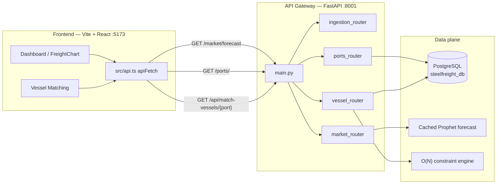

# ARTIFEX Architecture

**Maritime Intelligence System** — freight forecasting, port-constraint matching, and vessel selection for East Coast Indian bulk trades.

This document describes the system as implemented in this repository. It is intended for the engineering team and for hackathon judges reviewing the prototype.

---

## System Overview

ARTIFEX is a B2B operations console for bulk-freight planning. It answers two questions that charterers currently solve by spreadsheet and phone:

1. **Where are rates going?** A 30-day Prophet forecast of bulk freight proxies, rendered as a confidence-banded line chart on the command dashboard.
2. **Which ships can actually berth?** A constraint engine that compares each vessel’s draft, LOA (length overall), and beam against the destination port’s published limits, then returns only compatible tonnage.

The product surface is a single-page React application (FreightIQ UI) with four workspaces: **Dashboard**, **Vessel Directory**, **Route Analytics**, and **Port Constraints**. Live traffic from the UI is pinned to a FastAPI process on `http://localhost:8001` via a shared `apiFetch` client.

Data plane:

| Concern | Source of truth |
|---|---|
| Port limits (max draft / LOA / beam) | PostgreSQL `ports` |
| Vessel particulars (class, dimensions, DWT) | PostgreSQL `vessels` |
| 30-day rate forecast | Offline Prophet run, served as an in-process API cache |
| Market / ingestion payloads | FastAPI ingestion service (queue stub) |



---

## Tech Stack

### Frontend (Vite / React)

| Layer | Choice |
|---|---|
| Runtime | React 19 + React DOM 19 |
| Bundler / dev server | Vite 8 (`npm run dev`, default port **5173**) |
| Language | TypeScript 5.7 |
| Styling | Tailwind CSS v4 (`@tailwindcss/vite`) plus a terminal-style design system in `src/index.css` |
| Charts | Recharts (`AreaChart` / `Line` on the freight forecast) |
| HTTP | `frontend/src/api.ts` — `API_BASE_URL = "http://localhost:8001"` |

Canonical UI lives under `frontend/src/`. `App.tsx` is a client-side page switcher (no React Router): Dashboard, Vessel Directory, Route Analytics, Port Constraints, with a persistent sidebar and top bar.

Live backend bindings today:

- **Ports dropdown** — `GET /ports/` on Vessel Matching mount.
- **Matching table** — `GET /api/match-vessels/{selectedPort}` from **FIND MATCHING VESSELS**.
- **Forecast chart** — `GET /market/forecast` inside `FreightChart`.

### Backend (FastAPI)

| Layer | Choice |
|---|---|
| Framework | FastAPI (`backend/main.py`) |
| Server | Uvicorn on **port 8001** |
| DB driver | `psycopg2` with `RealDictCursor` (row → JSON-ready dict) |
| CORS | Explicit allow-list for Vite origins (`localhost:5173`, `127.0.0.1:5173`, plus 3000 / 8443) |
| Domain logic | `backend/engine.py` plus `match_vessels_against_port` in `vessel_router` |

The process is a **gateway**: one ASGI app, four routers mounted as internal microservices (see next section). OpenAPI is available at `/docs` when the server is running.

### Database (PostgreSQL)

Database name: **`steelfreight_db`** (local host, port `5432`). Schema is defined in `backend/schema.sql`.

**`ports`** — physical berth envelope used as the right-hand side of the matcher:

| Column | Role |
|---|---|
| `port_name` | Destination key used by the UI and `GET /api/match-vessels/{port}` |
| `max_draft` | Maximum allowable draft (m) |
| `max_loa` | Maximum length overall (m) |
| `max_beam` | Maximum beam (m) |

**`vessels`** — left-hand side of the matcher:

| Column | Role |
|---|---|
| `vessel_name` / `vessel_class` | Identity for the results table |
| `draft`, `loa`, `beam` | Compared to the port envelope |
| `cargo_capacity` | Deadweight / cargo tons for the UI |

If PostgreSQL is unreachable, `GET /ports/` degrades to a static East-Coast port list so the demo dropdown never goes blank.

---

## API Gateway & Microservices

`backend/main.py` is the **API gateway**. It constructs the FastAPI `app`, installs CORS, and `include_router`s each service. There is no extra `/api/v1` prefix on the app itself; each router owns its own path space.

```29:34:backend/main.py
# FIX 2: Removed the rogue "/api/v1" prefix and included all 4 microservices
app.include_router(ingestion_router.router, tags=["Ingestion Service"])
app.include_router(vessel_router.router, tags=["Vessel Constraints"])
app.include_router(vessel_router.match_router)
app.include_router(market_router.router)
app.include_router(ports_router.router)
```

| Service | Module | Base path | Responsibility |
|---|---|---|---|
| **Ingestion** | `routers/ingestion_router.py` | `POST /ingest/` | Accepts `{ source_id, data, metadata }` and acknowledges a queued ingest (Baltic / AIS-style payloads). |
| **Vessels** | `routers/vessel_router.py` | `POST /api/filter-vessels/` · `GET /api/match-vessels/{selected_port}` | Loads port + fleet from PostgreSQL, runs the constraint engine, returns compatible vessels as JSON. |
| **Market ML** | `routers/market_router.py` | `GET /market/forecast` | Serves the cached 30-day Prophet series (`date`, `forecast`, `lower`, `upper`). |
| **Ports** | `routers/ports_router.py` | `GET /ports/` | Returns `{ port_name }` rows for the Destination Port `<select>`. |

`GET /` is a liveness probe (`"ARTIFEX God Machine is Online."`).

**UI → gateway mapping**

| UI action | Method | Path |
|---|---|---|
| Load destination ports | `GET` | `/ports/` |
| Find matching vessels | `GET` | `/api/match-vessels/{selectedPort}` |
| Programmatic filter (draft / type / length) | `POST` | `/api/filter-vessels/` |
| Render 30-day freight chart | `GET` | `/market/forecast` |

---

## The Constraint Engine

Compatibility is a **linear scan**: one pass over the fleet, three inequality tests per ship. For \(N\) vessels this is **\(O(N)\)** time and **\(O(K)\)** extra memory for the \(K\) ships that pass.

The same predicate appears in the original batch script (`backend/engine.py`) and in the live API (`match_vessels_against_port`):

```text
compatible  ⇔  vessel.draft ≤ port.max_draft
            ∧  vessel.loa   ≤ port.max_loa
            ∧  vessel.beam  ≤ port.max_beam
```

**Why \(O(N)\) is the right bound.** Ports are a single lookup (`WHERE port_name = %s`). There is no pairwise vessel–vessel search and no nested loop over ports. Each vessel is examined exactly once. That keeps matching interactive even as the directory grows from the seed rows in `schema.sql` to a few dozen real hulls.

**Request path (Vessel Matching)**

1. Client sends `GET /api/match-vessels/{selectedPort}`.
2. `fetch_port_and_vessels_from_db` loads one port row and all vessel rows.
3. If the port is missing, the API returns `[]` (empty table, no crash).
4. `match_vessels_against_port` walks the list and emits dicts the UI maps onto name, class, draft, LOA, beam, and cargo capacity.

The POST filter endpoint applies the same \(O(N)\) pass, then optional secondary filters (`max_draft`, `min_length`, `vessel_type`) — still linear.

**Operational meaning.** A Capesize that exceeds Haldia’s tidal draft is dropped; a Handysize that clears draft, LOA, and beam is returned as a berthable candidate. That is the difference between a rate quote and a ship that can physically work the port.

---

## Machine Learning Strategy

Prophet is **not** fitted on the request path. Training is an offline job; serving is a **cached snapshot at the API layer**. That is what keeps the dashboard stable and effectively zero-latency during a live presentation.

### Offline training (`ml-engine/`)

`baseline_prophet.ipynb` trains Facebook Prophet on `cleaned_cmo_monthly_prices.csv` (World Bank / CMO-style monthly bulk-price proxy):

- `yearly_seasonality=True`, weekly/daily seasonality off (monthly fundamentals, not intra-week noise).
- `changepoint_prior_scale=0.05` to avoid overfit jumps.
- `make_future_dataframe(periods=30, freq='D')` for a 30-day daily horizon.
- Export: `forecast_30day.json` with Prophet columns `ds`, `yhat`, `yhat_lower`, `yhat_upper`.

Baltic-adjacent series (`cleaned_baltic_supramax.csv`) sit alongside as supporting market context.

### API-layer cache (presentation path)

`GET /market/forecast` in `market_router.py` returns a **precomputed JSON array already resident in the worker process**. There is no Stan/CmdStan fit, no CSV I/O, and no model pickle load per click.

Contract consumed by `FreightChart`:

```json
{ "date": "YYYY-MM-DD", "forecast": 65.2, "lower": 51.1, "upper": 79.2 }
```

That mapping is Prophet’s `ds` / `yhat` / `yhat_lower` / `yhat_upper` renamed for the charting library.

**Why this is the demo architecture**

| If we refit Prophet on every page load | What judges would see |
|---|---|
| Seconds of CmdStan on first paint | Spinner, or a hung chart |
| Numeric jitter between runs | “The graph changed” mid-pitch |
| Notebook / Python deps on the API box | Fragile laptop demo |

Caching the 30-day curve **in the API process** guarantees:

- **UI stability** — the same series for every `apiFetch('/market/forecast')` during the session.
- **Zero-latency rendering** — the handler is an in-memory return; Recharts only maps numbers to paths.
- **Decoupled ML** — data science can re-run the notebook and refresh the cache without touching React.

The Dashboard chart binds this array directly: X = `date`, line = `forecast`, band = `lower` / `upper`. Y-axis domain is derived from the live min/max so the confidence interval is never clipped.

---

## Local Setup Guide

Prerequisites: **Python 3.10+**, **Node.js 22** (see `frontend/.mise.toml`), **PostgreSQL** with database `steelfreight_db`. Apply `backend/schema.sql` (and any additional vessel/port inserts) before matching ships.

Install Python deps used by the API and engine (from the repo root or `backend/`):

```bash
pip install fastapi uvicorn psycopg2-binary
```

### 1. FastAPI backend — port 8001

From the repository root:

```bash
cd backend
python -m uvicorn main:app --reload --host 127.0.0.1 --port 8001
```

Confirm:

```bash
# Windows PowerShell
Invoke-RestMethod http://127.0.0.1:8001/
Invoke-RestMethod http://127.0.0.1:8001/ports/
Invoke-RestMethod http://127.0.0.1:8001/market/forecast
```

Interactive docs: [http://127.0.0.1:8001/docs](http://127.0.0.1:8001/docs).

### 2. Vite frontend — port 5173

In a **second** terminal, from the repository root:

```bash
cd frontend
npm install
npm run dev -- --port 5173 --host 127.0.0.1
```

Open [http://127.0.0.1:5173](http://127.0.0.1:5173). All `apiFetch` calls target `http://localhost:8001`.

**Smoke path for the pitch:** Dashboard chart loads without mock rates → Vessel Directory destination list is live ports → **FIND MATCHING VESSELS** fills the table from the \(O(N)\) engine.

---

*ARTIFEX — Intelligent Freight Forecasting Model. Prototype architecture, engineering team + hackathon review.*
